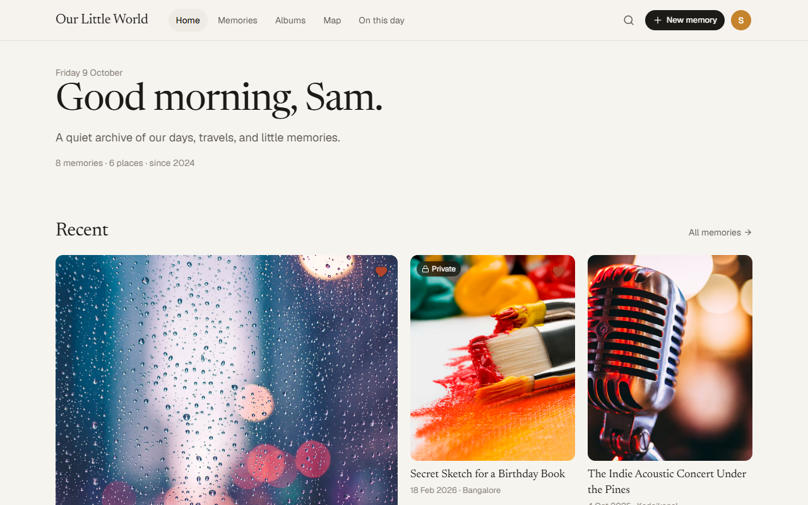
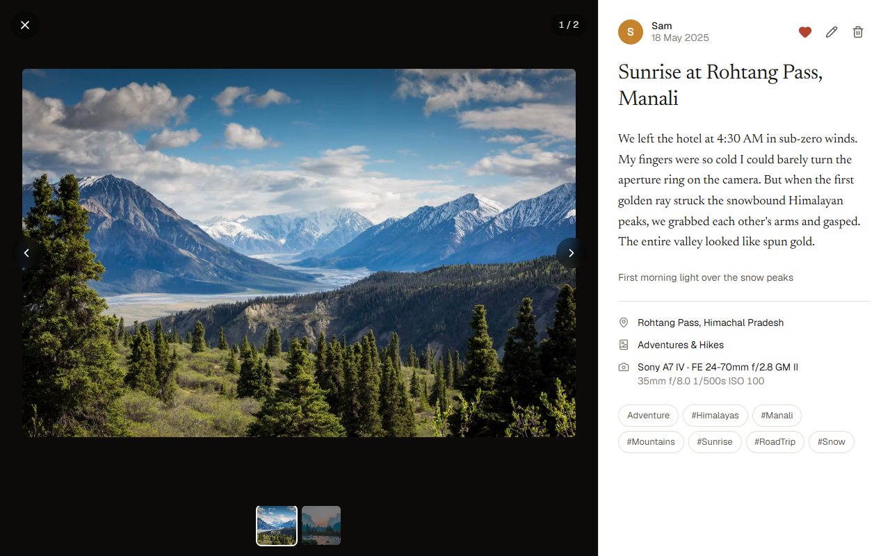
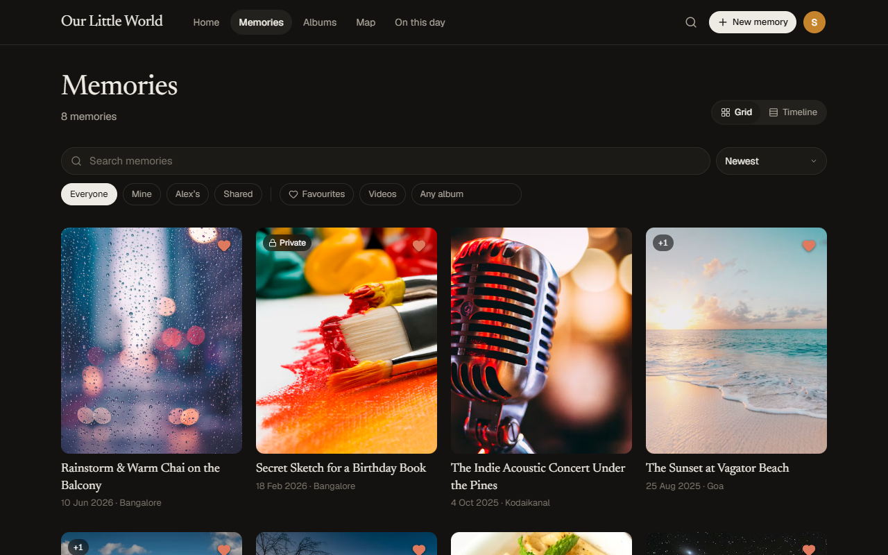
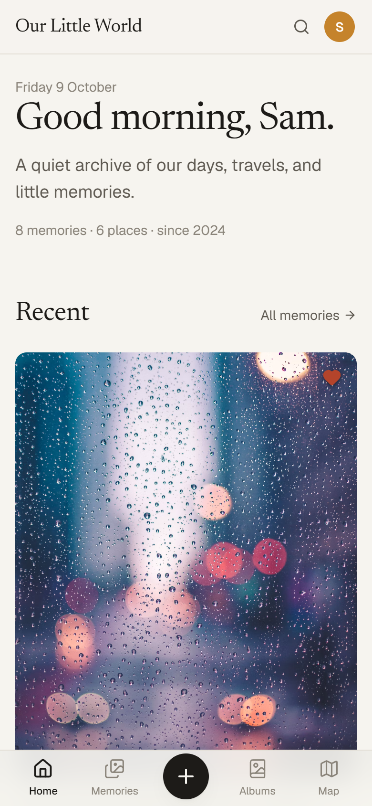

# Little World

A private photo journal for two. Each of you adds photos, videos and the story behind them from your own phone or laptop, and everything stays in sync through a Google Drive you own, organised into folders you can actually browse.



| Memory viewer | Dark mode | Phone |
| --- | --- | --- |
|  |  |  |

## Features

- **Memories** – photos and videos with a title, the story behind them, date, place, album, mood and tags. Date and location are read from the photo’s EXIF data when available.
- **Ways to browse** – a home page with recent memories and an *on this day* flashback, a searchable grid or timeline with filters, albums, a map of everywhere you’ve been, and *on this day* across past years.
- **Two profiles** – each person has a PIN. Memories can be shared or private; private ones only show up for the person who wrote them.
- **Local first** – everything is stored in the browser (IndexedDB), so the app is fast and works offline.
- **Google Drive backup and sync** – originals are uploaded into per-person folders, and both devices stay in sync through Drive.
- **Light, dark and system themes**, a mobile-first layout, and a web app manifest so it can be added to the home screen.

## How sync works

Connecting Google Drive creates this structure in the account you sign in with:

```
Our Little World/
├── <Partner 1>/   Photos/  Videos/     private memories by partner 1
├── <Partner 2>/   Photos/  Videos/     private memories by partner 2
└── Shared/        Photos/  Videos/     shared memories from either of you
                   Metadata/our-little-world.json
```

- Files get readable names such as `2025-08-25 Sunset at Vagator.jpg`.
- `our-little-world.json` holds the stories, albums and profiles. Each device pulls it, merges it with what it has (the most recent edit wins, and deletions are recorded so they don’t come back), downloads any photos it’s missing, uploads its own, and writes the file back only when something changed.
- Sync runs when the app opens, every minute while it’s open, and whenever it comes back to the foreground. Uploads that didn’t finish are picked up again on the next run.
- Making a memory private moves its files out of `Shared/`; deleting a memory moves its files to Drive’s trash.
- The app only asks for the `drive.file` permission, so it can see the files it created and nothing else in your Drive.

Both people connect the **same** Google account, since that’s where the archive lives. “Private” therefore means hidden inside the app, not hidden from someone who opens the Drive folders directly.

## Getting started

Requires Node.js 20.19 or newer.

```bash
npm install
cp .env.example .env.local   # then fill in the values
npm run dev                  # http://localhost:5173
```

On a new device the app asks who’s using it. Both profiles start with the PIN `1234`; change it under **Settings → General**.

### Google Drive setup

1. In the [Google Cloud Console](https://console.cloud.google.com/), create a project and enable the **Google Drive API**.
2. Under **APIs & Services → Credentials**, create an **OAuth client ID** of type *Web application*. Add `http://localhost:5173` and your deployed URL to **Authorized JavaScript origins** (no redirect URI is needed).
3. On the **OAuth consent screen**, add the Google account you’ll use as a test user (or publish the app).
4. Put the client ID in `.env.local` as `VITE_GOOGLE_CLIENT_ID`, restart the dev server, then use **Settings → Backup & sync → Connect Google Drive**.

## Configuration

| Variable | Purpose |
| --- | --- |
| `VITE_GOOGLE_CLIENT_ID` | OAuth client ID used for Google sign-in. Required for Drive. |
| `VITE_PARTNER_1_NAME`, `VITE_PARTNER_2_NAME` | Names the two profiles start with on a fresh install. Defaults to “Partner 1” and “Partner 2”; both can be renamed in Settings. |
| `VITE_DRIVE_ROOT_FOLDER_ID` | Optional existing Drive folder to use as the archive root. Ignored unless the app can write to it. |

`.env.local` is used by `npm run dev`; `.env.production` (also git-ignored) is used by `npm run build`.

## Scripts

| Command | What it does |
| --- | --- |
| `npm run dev` | Start the dev server on port 5173 |
| `npm run build` | Type-check and build to `dist/` |
| `npm run preview` | Serve the production build locally |
| `npm run lint` | Lint with oxlint |

## Deploying

The build is a static site, so any static host works. With Vercel:

```bash
npx vercel deploy --prod
```

Remember to add the deployed URL to the OAuth client’s authorized JavaScript origins.

## Project structure

```
src/
├── components/   UI, grouped by screen (home, memory, collections, map, auth, settings, common)
├── context/      React state: auth/profiles, memories and sync status, theme
├── services/     IndexedDB access, memories, albums, profiles, media processing
│   └── storage/  Google Drive client, sync engine and merge logic
├── lib/          Formatting helpers
└── types/        Shared TypeScript types
```

## Built with

React 19, TypeScript, Vite, Tailwind CSS 4, IndexedDB via `idb`, Leaflet for the map, and `exifr` for photo metadata.
